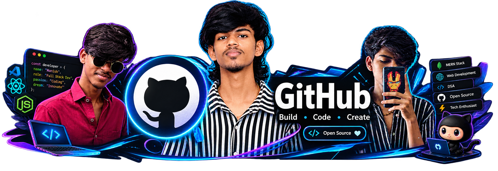
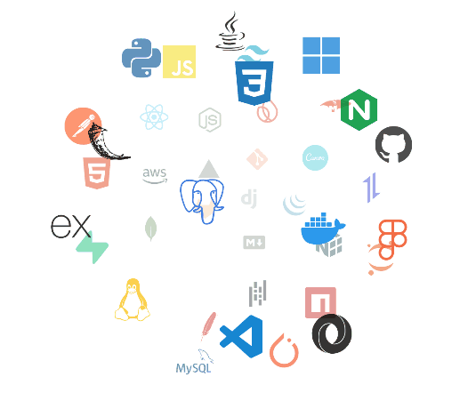
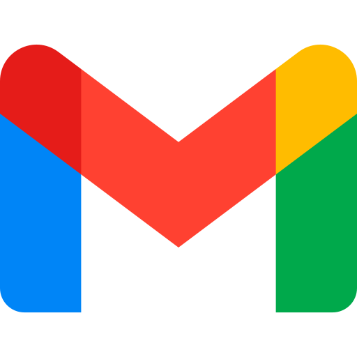

<!-- just a normal greeting  -->

  

<!--name popup -->

 
  

<!--Banner -->

<!-- Night Owl image -->

  

<!-- Header
<h1 align="center">
  
  Hello, I'm <strong>JManishkanna</strong>
</h1>
<h2 align="center">Full Stack Developer</h2> -->

 
 

<!-- Intro -->

  
  
  

  I’m a passionate <strong>frontend developer</strong> who enjoys creating clean, modern, and user-friendly web experiences.  
  I love turning ideas into visually appealing and interactive interfaces using HTML, CSS, JavaScript, and thoughtful problem-solving.

---

<h2>🚀 About Me</h2> 

- 🌐 Interested in web design and frontend development
- 💡 Enjoy building responsive and interactive user interfaces
- 🎨 Focused on clean UI/UX and modern design patterns
- 📚 Constantly learning new tools, technologies, and best practices
- 🔭 Exploring creative ways to improve digital experiences

---

## 🛠️ Tech Stack

  
  
  
  
  
  

<!-- Skills and Blogs -->
<h2 align="center">Tᴇᴄʜ sᴛᴀᴄᴋ & Lᴀᴛᴇsᴛ ʙʟᴏɢs</h2>

<picture>
  <source media="(prefers-color-scheme: dark)" srcset="./Skills_Animation_Dark.gif">
  <source media="(prefers-color-scheme: light)" srcset="./Skills_Animation_White.gif">
  
</picture>

 

<h3 align="left">Current Learning</h3>
<ul align="left">
  <li>Currently Learning And Deepening my knowledge MERN to develope My MERN Stack Skills.</li>
  <li>Deepening my knowledge in Backend and Databases.</li>
  <li>Exploring advanced React.js patterns and state management techniques.</li>
</ul>

 
 

 

<!-- Contribution Graph -->
<h2 align="center">📈 Contribution Graph 📈</h2>

  

---

<!-- Daily Quote -->
<h2 align="center">🌟 Thought of the Day 🌟</h2>

<!--STARTS_HERE_QUOTE_CARD-->

  

<!--ENDS_HERE_QUOTE_CARD-->

---

<!-- Contact -->
<h2 align="center">🤝 Connect With Me 🤝</h2>

  

 

  

  

 

<!-- Footer -->

  

